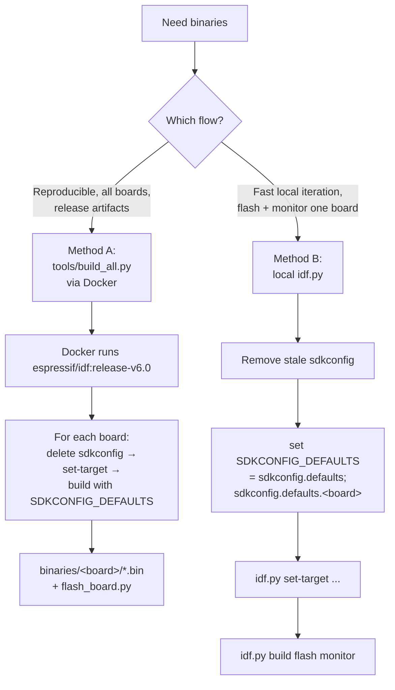
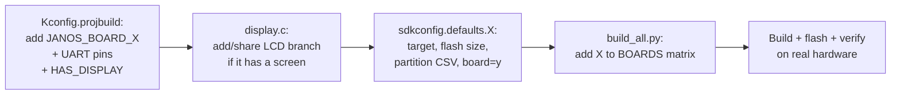

# Building & Flashing Mate (JanOS Web Client)

This document describes how the firmware is built for every supported board, the
two build flows (containerized vs. local), how flashing works, and how to add a
new board.

The application is a single ESP-IDF project (`janos-web-client`) that is compiled
into **per-board permutations**. Each board differs by MCU target, flash size,
partition layout, display driver, and Grove UART pins — all selected through
`Kconfig` options and `sdkconfig.defaults.*` fragments.

---

## 1. Supported boards

| Board          | MCU              | Flash | Display            | UART TX/RX (Grove) | Notes                          |
|----------------|------------------|-------|--------------------|--------------------|--------------------------------|
| `xiao-c6`      | ESP32-C6         | 4 MB  | —                  | 21 / 20            | Default board in Kconfig       |
| `nanoc6`       | ESP32-C6         | 4 MB  | —                  | 2 / 1              | M5Stack NanoC6                 |
| `cores3`       | ESP32-S3         | 16 MB | ILI9342C 320×240   | 2 / 1              | CoreS3 SE                      |
| `atoms3r`      | ESP32-S3         | 8 MB  | GC9107 128×128     | 5 / 6              | AtomS3R Dev Kit                |
| `atoms3`       | ESP32-S3FN8      | 8 MB  | GC9107 128×128     | 2 / 1              | Shares LCD code with AtomS3R   |
| `atoms3-lite`  | ESP32-S3FN8      | 8 MB  | —                  | 2 / 1              | No display                     |
| `stickc-plus2` | ESP32            | 8 MB  | ST7789V2 135×240   | 32 / 33            | Bootloader @ 0x1000            |
| `sticks3`      | ESP32-S3         | 8 MB  | ST7789P3 135×240   | 9 / 10             | M5PM1 PMIC (5V boost + L3B)    |
| `atom-lite`    | ESP32-PICO-D4    | 4 MB  | —                  | 26 / 32            | Needs no-stub flashing fallback|

> UART TX is the Grove **yellow** wire, RX the **white** wire. If the Monster does
> not respond or you see garbage on RX, swap TX/RX in `main/Kconfig.projbuild`.

---

## 2. How a build is configured

Configuration is layered. ESP-IDF reads, in order:

```
sdkconfig.defaults            (common to all boards)
sdkconfig.defaults.<board>    (per-board: target, flash size, partitions, board select)
        │
        ▼
   generated  sdkconfig        ← what idf.py actually compiles from
        │
        ▼
   main/Kconfig.projbuild       provides defaults for any symbol NOT already
                                pinned in sdkconfig (board, display geometry,
                                UART pins via `default N if JANOS_BOARD_*`)
```

Key files:

- **`main/Kconfig.projbuild`** — the `JANOS_BOARD_*` choice, `JANOS_HAS_DISPLAY`,
  and the per-board UART pin defaults.
- **`sdkconfig.defaults`** — settings common to every board (HTTP server, lwIP,
  SPIFFS, logging, main task stack).
- **`sdkconfig.defaults.<board>`** — pins the target chip, flash size, partition
  CSV, the `CONFIG_JANOS_BOARD_*=y` selection, and (StickS3 only) PSRAM.

> ⚠️ **The #1 gotcha:** a Kconfig `default` only applies when the symbol is **not
> already present** in `sdkconfig`. A stale `sdkconfig` from a previous board will
> silently keep old values (commonly the UART pins). See Troubleshooting.

---

## 3. Build flows



### Method A — `tools/build_all.py` (containerized, all boards)

Mirrors the CI matrix. Builds each board in an isolated Docker container
(`espressif/idf:release-v6.0`), collects artifacts into `binaries/<board>/`, and
generates a per-board `flash_board.py`.

```bash
# Build every board in the matrix
python tools/build_all.py

# Build only specific boards
python tools/build_all.py --targets sticks3,atoms3,atoms3-lite

# Keep the per-board build-<board>/ dirs for inspection
python tools/build_all.py --targets cores3 --keep-build
```

Requirements:
- **Docker** running (the script runs `docker info` first and aborts otherwise).
- First run pulls the `espressif/idf:release-v6.0` image and populates a local
  `.espressif/` toolchain cache (subsequent runs are much faster).

> ⚠️ `build_all.py` **wipes the entire `binaries/` directory** at the start of
> every run (`shutil.rmtree`) and recreates it. Anything you add there manually
> (e.g. a custom top-level script) is deleted on the next run.

### Method B — local `idf.py` (fast single-board iteration)

Use this to flash + monitor one board on real hardware.

```powershell
# From the repo root, in an ESP-IDF environment
Remove-Item sdkconfig, sdkconfig.old -Force -ErrorAction SilentlyContinue
$env:SDKCONFIG_DEFAULTS = "sdkconfig.defaults;sdkconfig.defaults.sticks3"
idf.py set-target esp32s3
idf.py build flash monitor -p COM_X
```

Swap `sdkconfig.defaults.sticks3` and `set-target esp32s3` for the board you
want (see the matrix). For ESP32-C6 boards use `set-target esp32c6`; for the
classic ESP32 boards use `set-target esp32`.

> **Always delete `sdkconfig` first** when switching boards. `idf.py clean` does
> **not** remove it — it only cleans `build/`.

---

## 4. Flashing

### Per-board flasher (generated by `build_all.py`)

Each `binaries/<board>/flash_board.py` is self-contained — it knows the chip,
flash size/mode/freq and the four image offsets. It auto-installs `esptool` +
`pyserial` into a local venv if missing.

```bash
cd binaries/sticks3
python flash_board.py                 # auto-detect port
python flash_board.py --port COM13
python flash_board.py --baud 115200   # slower, more robust link
python flash_board.py --erase         # full erase first
python flash_board.py --monitor       # open serial monitor after flashing
python flash_board.py --no-stub       # force the no-stub path (see below)
```

**Automatic no-stub fallback:** some ESP32 modules (notably the **ESP32-PICO-D4**
on Atom Lite) drop the esptool *stub* when the baud is bumped, failing with
`The chip stopped responding`. The generated flasher detects a failed flash and
automatically retries once with `--no-stub -b 115200` (slower but reliable).

### Manual esptool (fallback)

```bash
python -m esptool --chip esp32s3 -p COM13 -b 460800 \
  --before default-reset --after hard-reset \
  write-flash --flash-mode dio --flash-freq 80m --flash-size 8MB \
  0x0     bootloader-sticks3.bin \
  0x8000  partition-table-sticks3.bin \
  0x10000 mate-sticks3.bin \
  0x3d0000 storage-sticks3.bin
```

> Classic-ESP32 boards (`stickc-plus2`, `atom-lite`) place the bootloader at
> **0x1000**, not 0x0. The per-board flasher handles this automatically.

### Output layout

```
binaries/
  <board>/
    mate-<board>.bin             ← application
    bootloader-<board>.bin
    partition-table-<board>.bin
    storage-<board>.bin          ← SPIFFS (web UI assets)
    flash_board.py               ← board-specific flasher
```

---

## 5. Runtime behavior on display boards

Boards with `JANOS_HAS_DISPLAY=y` show a 4-row UI:

- **No Wi-Fi client connected** → a "connect" splash: SSID, password, URL.
- **Client connected** → operational view: status, last TX command, last RX
  line, RX line count.

The view switches automatically on Wi-Fi AP STA connect/disconnect events.
Headless boards (`*-lite`, `xiao-c6`, `nanoc6`) confirm success via the serial
log (`RX: ping` / `RX: pong` against the Monster).

### StickS3 power note

StickS3 has an **M5PM1 PMIC** (I²C `0x6E` on GPIO47/48). `main/power_sticks3.c`
runs at boot **before** `display_init()` to:
1. enable the 5 V boost (`PWR_CFG` 0x06 bit3) so Grove PORT.A is powered, and
2. force the **L3B** rail on (M5PM1 GPIO2) so the LCD has power.

This must run before display init — enabling the boost causes an inrush dip on
the shared rail that would otherwise corrupt an already-initialized LCD.

---

## 6. Adding a new board



Checklist:

1. **`main/Kconfig.projbuild`**
   - Add `config JANOS_BOARD_X` to the `choice` (with the right `depends on
     IDF_TARGET_*`).
   - Add `default <pin> if JANOS_BOARD_X` for `JANOS_UART_TX_PIN` / `_RX_PIN`.
   - If no screen, add `default n if JANOS_BOARD_X` under `JANOS_HAS_DISPLAY`.
2. **`main/display.c`** — add a board branch (or extend an existing `#elif` if the
   panel + pinout match an existing board, as AtomS3 reuses the AtomS3R branch).
3. **`sdkconfig.defaults.X`** — set `CONFIG_IDF_TARGET`, flash size, partition CSV
   (`partitions_4mb.csv` / `partitions_8mb.csv` / `partitions_16mb.csv`), and
   `CONFIG_JANOS_BOARD_X=y`. Enable PSRAM only if the module has it.
4. **`tools/build_all.py`** — add an entry to the `BOARDS` dict (target, defaults,
   chip, flash size/mode/freq, offsets). Use the partition CSV to derive
   `spiffs_offset` = `0x10000 + <factory app size>`.
5. **Verify on hardware** — display geometry, Grove TX/RX orientation, and
   (if applicable) any PMIC/power init.

---

## 7. Troubleshooting

| Symptom | Cause | Fix |
|---|---|---|
| Log shows wrong UART pins, build warns *"Default value … mismatch … Using default value from sdkconfig"* | Stale `sdkconfig` keeps old per-board values; Kconfig defaults are ignored when the symbol already exists | Delete `sdkconfig` (and `sdkconfig.old`) before reconfiguring — `idf.py clean` does **not** remove it |
| Display geometry wrong (e.g. `320x240` on a 135×240 board) | Built with the wrong `JANOS_BOARD_*` | Rebuild with the correct `sdkconfig.defaults.<board>`; confirm `CONFIG_JANOS_BOARD_*` in the generated `sdkconfig` |
| Bootloop with `octal_psram: PSRAM chip is not connected` / `Failed to init external RAM` | `CONFIG_SPIRAM=y` on a no-PSRAM module (e.g. ESP32-S3**FN8** AtomS3/Lite) — leaked from a PSRAM board's config | No-PSRAM board defaults explicitly carry `# CONFIG_SPIRAM is not set`; `build_all.py` applies defaults via `-D` per board and verifies the generated `sdkconfig` afterwards. Rebuild via `build_all.py` and reflash |
| `esptool ... The chip stopped responding` after *"Changing baud rate"* | ESP32-PICO-D4 stub drops at high baud | `python flash_board.py --baud 115200`, or rely on the auto no-stub fallback, or `--no-stub` manually. Try another USB cable/port |
| StickS3: no 5 V on Grove | M5PM1 5V boost disabled by default | `power_sticks3.c` sets `PWR_CFG` bit3 at boot — ensure the board is built as `sticks3` |
| StickS3: LCD dark after enabling Grove 5V | Enabling the boost dropped the L3B rail | `power_sticks3.c` forces M5PM1 GPIO2 (L3B) on, before `display_init()` |
| `binaries/` lost custom files after a build | `build_all.py` wipes `binaries/` each run | Don't store hand-made files under `binaries/`; keep tooling in `tools/` |
| Monster silent / garbage RX | Wrong Grove pin orientation | Swap TX/RX defaults for the board in `main/Kconfig.projbuild` |
